<p align="center">
  
</p>

# REZANOVA CLASSWIZ CALCULATOR

<p align="center">
  <a href="./LICENSE"></a>
  <a href="https://github.com/AhmedAlnasser2000/REZANOVA-CAS-CALCULATOR/releases"></a>
  <a href="https://github.com/AhmedAlnasser2000/REZANOVA-CAS-CALCULATOR/commits/main"></a>
  <a href="https://rezanova-cas.com"></a>
</p>

<p align="center"><sub>The browser version runs the current engines. The last Linux packages (v0.3.0) predate them — see <a href="#preview-release">Preview release</a>.</sub></p>

REZANOVA is an open-source mathematics workbench: **solve equations, draw graphs and find integrals exactly — every answer checked before it is shown.** It is built with Tauri, React, TypeScript, Rust and MathLive, and runs in the browser or as a Linux desktop app.

When a problem can be decided, REZANOVA gives the exact answer with its conditions and verifies it independently. When it cannot be decided yet, it says so with a stated reason. It never shows a partial answer or a guess.

`Calcwiz` and `Classwiz` are friendly aliases. The primary public identity is **REZANOVA CLASSWIZ CALCULATOR**.

## Project status

- **Current version:** `0.3.0` (last packaged release); the source tree is far ahead of it.
- **License:** MIT. **Platforms:** browser, and Linux-first desktop (Tauri 2). **Frontend:** React 19 + TypeScript + Vite.
- **Development is paused.** It will resume next year, with no date promised.

### Why REZANOVA was rebuilt

The first engines grew one family at a time. Equation began with simple solving, then higher degrees behind caps, then complex numbers, then inequalities, then Cardano's and Ferrari's formulas for cubics and quartics. Each step was another special route, and the other workspaces grew the same way. It worked, but it could never become general: there are always more families than routes.

That limitation saddened me, so instead of adding the next family I started over. The new Equation and Integration engines were built on general algorithms and decision procedures from day one. They handle whole classes of problems instead of lists of cases.

- **Equation** works in exact algebra over the rationals and algebraic numbers. It uses Gröbner bases, cylindrical algebraic decomposition, quantifier elimination and certified numerics, and checks every answer before showing it.
- **Integration** uses Risch-style decision procedures over differential fields. For the classes it covers so far, it decides whether an elementary antiderivative exists instead of trying patterns.

### Where it stands

Equation, Graphing and Integration came out of this far stronger. The other workspaces will be rebuilt the same way and can't be opened until then. Development is paused now so I can catch up on my studies; it will resume next year.

| Open now | Being rebuilt (visible, signed "Unavailable: being rebuilt") |
| --- | --- |
| Equation (the starting workspace), Graphing, New Integration, Notebook, Settings, History, Guide | Calculate, Table, Matrix, Vector, Calculus, Trigonometry, Geometry, Statistics, Labs |

`src/lib/workspaces/availability.ts` decides which workspaces open. Tests of the workspaces being rebuilt stay on disk but out of CI (`tools/retired-workspace-tests.mjs`).

## Equation

Equation runs on a private core, `src/lib/symbolic-engine/equation/`, rebuilt in seventeen stages ([roadmap](docs/architecture/equation/equation-reconstruction-roadmap.md)). The old Equation engine was retired in stage 17.

- **Rows:** one relation per row (=, ≠, <, ≤, >, ≥), or relations joined with ∧, ∨ and ¬, with ∀ / ∃ prefixes. All rows hold together. <kbd>Enter</kbd> solves; <kbd>Shift</kbd>+<kbd>Enter</kbd> adds a row.
- **Unknowns** are picked automatically and can be changed. Every other letter is a parameter, and answers split into exact cases over the parameters. Rows on parameters only are assumptions ("Assuming a > 0").
- **What it decides, over ℝ and ℂ:**
  - polynomial and rational equations and inequalities of any degree, with exact `RootOf` numbers when no radical formula exists;
  - exponentials, logarithms and Lambert W; absolute values and radicals; deep compositions;
  - trigonometric equations and inequalities as exact periodic families;
  - parametric problems as case trees;
  - polynomial systems (Gröbner bases, exact points in one number field, positive-dimensional families);
  - real regions in several unknowns by cylindrical algebraic decomposition, written like Mathematica's `Reduce`;
  - ∀ and ∃ by quantifier elimination: ∀x: x² + ax + 1 > 0 gives −2 < a < 2;
  - certified numeric roots and square systems, proven by interval Newton and Krawczyk tests, when no closed form exists.
- **Every answer is verified independently** (substitution, number-field checks, certificates, or a second decomposition), then replayed through the typed Equation result contract.
- **Non-answers are honest:** nothing partial is shown; a problem that cannot be decided yet names the reason.
- **Presentation:** Exact, Decimal (certified digits) or Both; "Conditions used"; copy as text or LaTeX.

The decomposition is doubly exponential in the number of variables, so four or more unknowns may end at the work limit. Quantifiers are decided for real polynomial rows only. Open items are in the roadmap's follow-up ledger.

<table>
  <tr>
    <td width="50%">
      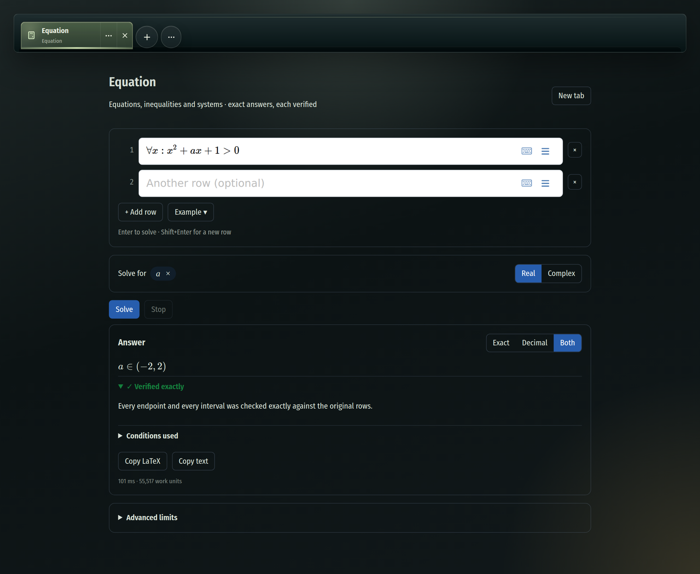
      <br />
      <sub><b>Quantifiers.</b> <code>∀x: x² + ax + 1 &gt; 0</code> decided by quantifier elimination: <code>a ∈ (−2, 2)</code>, verified exactly.</sub>
    </td>
    <td width="50%">
      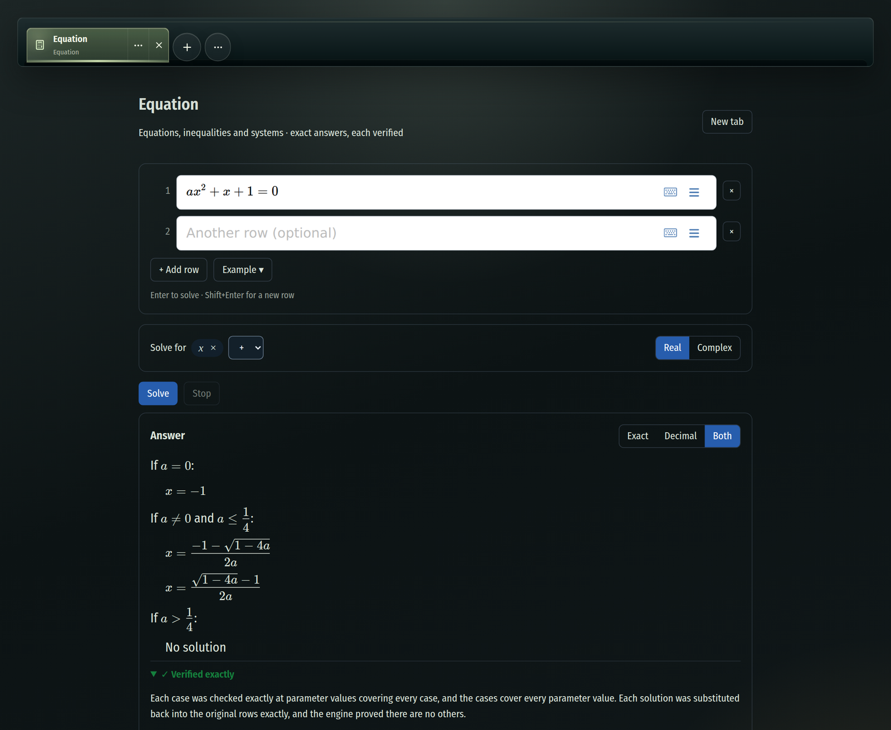
      <br />
      <sub><b>Parameters.</b> <code>ax² + x + 1 = 0</code> as exact cases over <code>a</code>, each checked at parameter values covering every case.</sub>
    </td>
  </tr>
  <tr>
    <td colspan="2">
      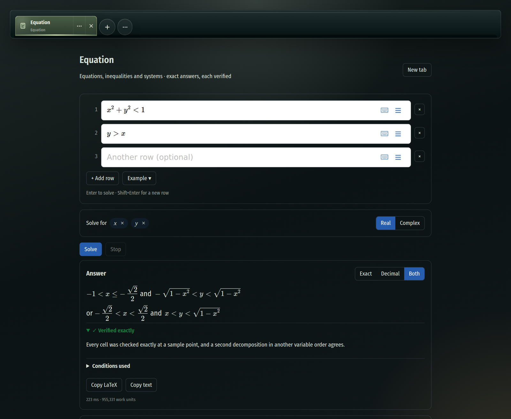
      <br />
      <sub><b>Regions.</b> <code>x² + y² &lt; 1</code> and <code>y &gt; x</code> as a cylindrical decomposition, written like <code>Reduce</code>.</sub>
    </td>
  </tr>
</table>

## Integration

New Integration (`src/lib/calculus/new-integration/`, `src/app/new-integration/`) is being rebuilt by its own program on Risch-style decision procedures ([roadmap](docs/architecture/calculus/integration-reconstruction-roadmap.md)). Today it takes one indefinite integral of a rational expression in the variable and one exponential family, and returns either an antiderivative checked by differentiation or a proof that no elementary antiderivative exists. The answer is shown first, then checked; saved derivations can be reopened and re-verified.

<table>
  <tr>
    <td width="50%">
      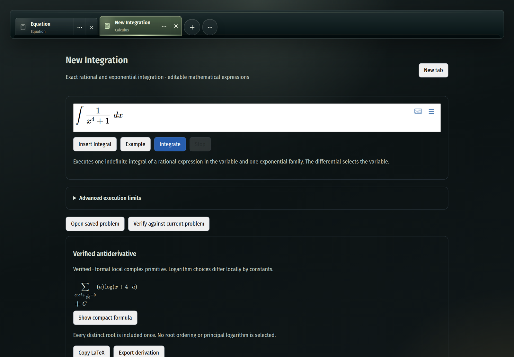
      <br />
      <sub><b>Rational integrals.</b> <code>∫ 1/(x⁴ + 1) dx</code> as a verified sum of logarithms over the roots of an exact polynomial.</sub>
    </td>
    <td width="50%">
      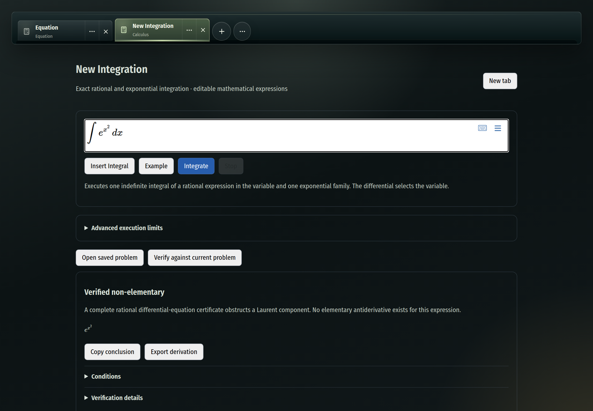
      <br />
      <sub><b>Non-elementary proofs.</b> <code>∫ e^{x²} dx</code>: a complete certificate proves no elementary antiderivative exists.</sub>
    </td>
  </tr>
</table>

## Graphing

Graphing is opened through **New Graph**: type relations and they are drawn, traced and analysed in a Real view, a Complex view, or both side by side.

- **What you can graph:** explicit and implicit relations (`x² + y² = 9`, `sin(x − y) = 6x`); inequality regions and chained conditions; parametric and polar curves; piecewise functions in a brace editor, each branch in its own colour; point sets, notes and sliders; real surfaces `z = f(x, y)` in an interactive 3D view; complex maps `f(z)` as domain colouring or four Re / Im / |f| / arg panels; complex loci and roots on an Argand plane.
- **How it is drawn:** implicit curves, regions, domain colouring, loci and surfaces run in WebGL2 shaders, with the CPU path as the exact reference and fallback. Interval arithmetic rules out empty cells so thin features and touching curves are not missed, and poles are never joined.
- **Tracing and proofs:** every readout carries a badge — exact, proved (an interval-arithmetic Krawczyk proof), verified, or numeric. Points of interest, intersections, piecewise boundaries and asymptotes are found and named exactly where possible; Analyze counts zeros and poles of a complex map by the argument principle.
- **The workspace:** a full-window layout that adapts from phone-narrow to ultra-wide windows, four themes, accessible colours, equal axes, undo and redo, and an Examples gallery.

Still to come in Graphing: tracing on 3D surfaces, Riemann sheets, export and presentation, durable graph projects, and "Open in Graph" from other workspaces.

<table>
  <tr>
    <td width="50%">
      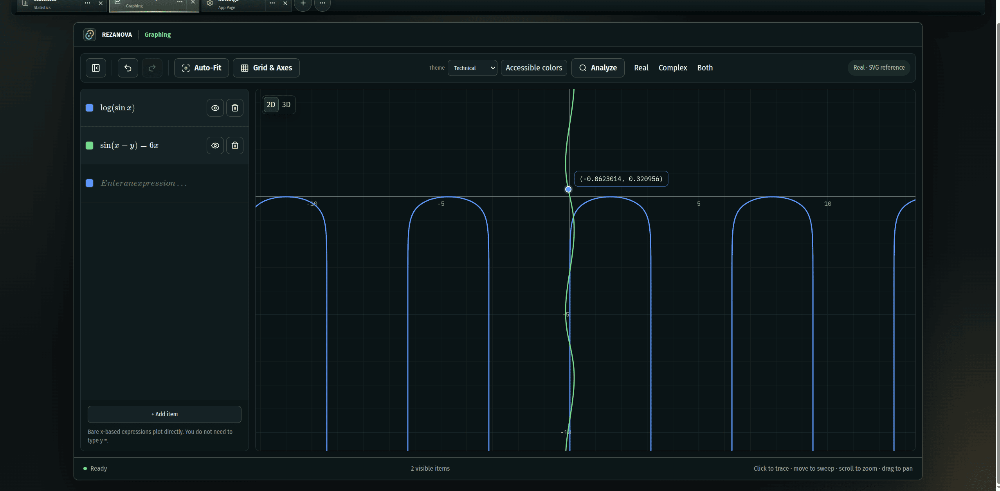
      <br />
      <sub><b>Implicit relations.</b> <code>sin(x−y)=6x</code> with click-to-trace.</sub>
    </td>
    <td width="50%">
      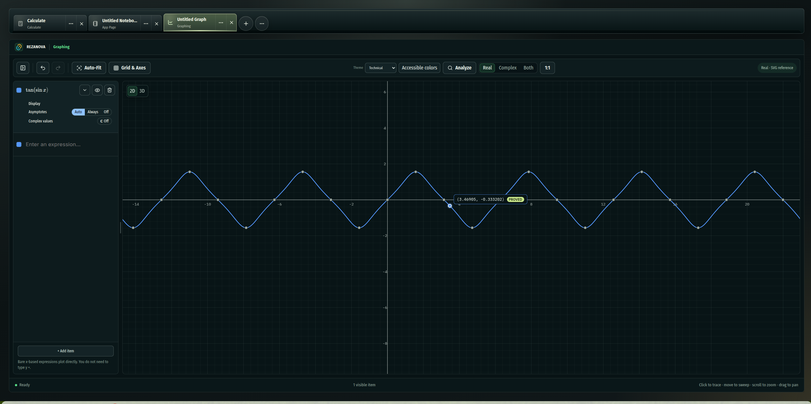
      <br />
      <sub><b>Proved readouts.</b> <code>tan(sin x)</code> with roots and extrema; the trace carries a <code>PROVED</code> badge.</sub>
    </td>
  </tr>
  <tr>
    <td width="50%">
      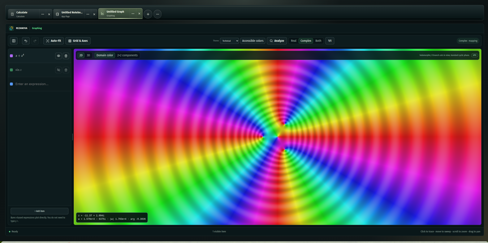
      <br />
      <sub><b>GPU domain colouring.</b> <code>z + z⁴</code> in a WebGL2 shader, with <code>z</code>, <code>w</code>, <code>|w|</code> and <code>arg</code> at the traced point.</sub>
    </td>
    <td width="50%">
      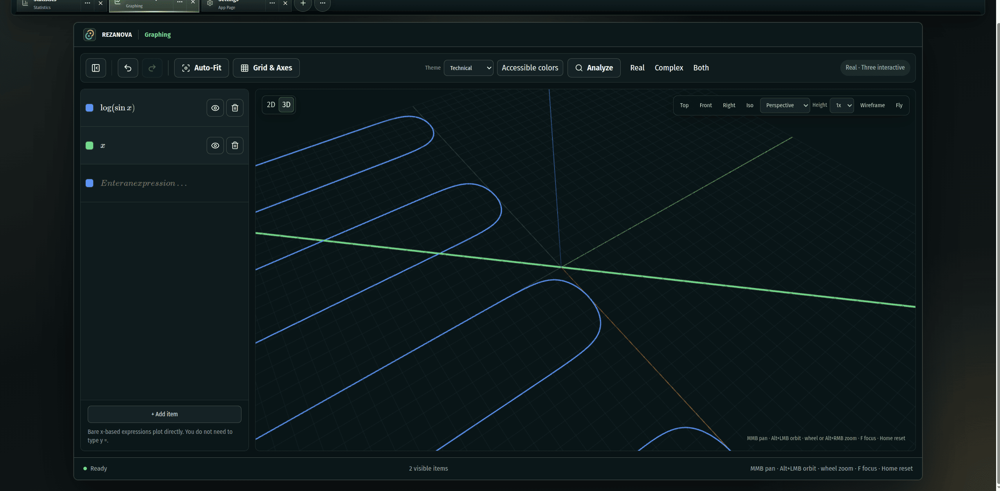
      <br />
      <sub><b>3D.</b> Surfaces with orbit, pan, zoom and Top/Front/Right/Iso/Fly cameras.</sub>
    </td>
  </tr>
  <tr>
    <td width="50%">
      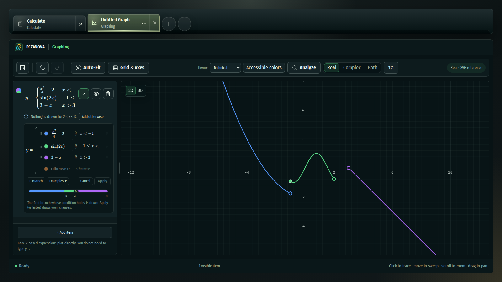
      <br />
      <sub><b>Piecewise brace editor.</b> Coloured branches, drag to reorder, and a strip showing where each branch is drawn.</sub>
    </td>
    <td width="50%">
      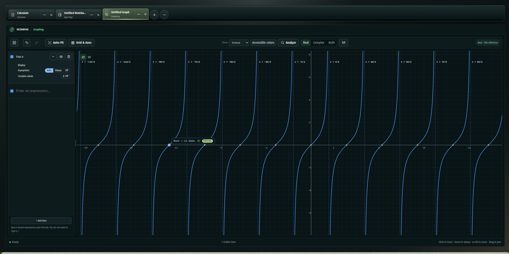
      <br />
      <sub><b>Asymptotes named exactly.</b> <code>tan x</code> with <code>x = π/2</code>, <code>x = 3π/2</code>, …</sub>
    </td>
  </tr>
</table>

## Notebook

Notebook is a document workspace for teaching, technical writing and worked examples: rich text and structured blocks, MathLive mathematics, page setup with headers, footers and page numbers, local images with captions, crop and rotation, an outline, templates, a local library with autosave, revisions, recovery and Trash, lossless `.cwiznb` packages, and export to PDF, editable DOCX and offline Web. Video is not supported; image and object interaction is still being consolidated.

<table>
  <tr>
    <td width="50%">
      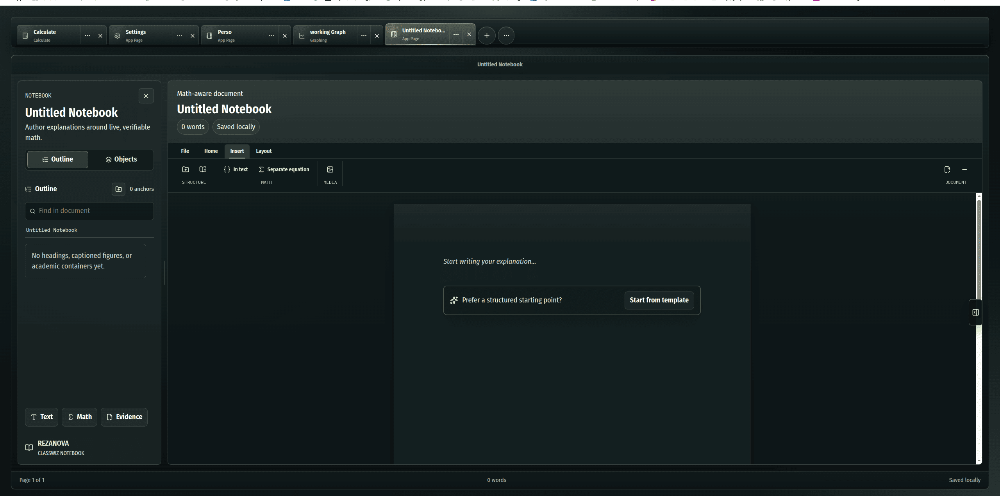
      <br />
      <sub><b>Insert tab.</b> Structure, math blocks and media.</sub>
    </td>
    <td width="50%">
      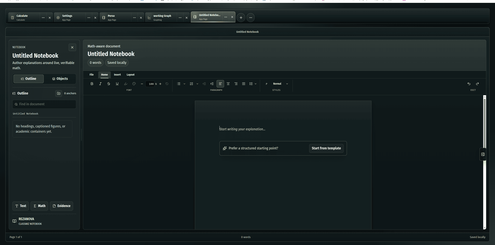
      <br />
      <sub><b>Home tab.</b> The rich-text formatting toolbar.</sub>
    </td>
  </tr>
</table>

## App surfaces

- **Workspace tabs** with independent state, rename, duplicate and close.
- **History:** a searchable ledger with filters and result inspection. It was cleared once when Equation was rebuilt, so saved results come from the new engines.
- **Settings** as a full page: scale, high contrast, notation and Notebook preferences, with live previews.
- **Guide:** searchable examples and help. Examples that open a workspace being rebuilt are refused with the same sign.

### Layout and UI scale

The whole app scales natively (80–200 %; <kbd>Ctrl</kbd> <kbd>+</kbd> / <kbd>−</kbd> / <kbd>0</kbd> on desktop, the browser's own zoom on the web), and workspaces rearrange themselves for the space they get: Graphing follows window size classes, folding toolbar controls into a **…** menu and turning the expression list into a drawer in narrow windows.

## Mathematical honesty and current boundaries

- REZANOVA is **not** a complete general-purpose CAS. Its engines decide whole classes of problems, not every problem; anything outside them ends with a stated reason.
- Equation's decomposition is doubly exponential in the number of variables; quantifiers are decided for real polynomial rows only.
- Integration currently accepts rational expressions in the variable and one exponential family; logarithmic, trigonometric and algebraic integrands and definite integrals are still being added.
- Graphing's Riemann work, export and durable projects are unfinished; complex zero/pole evidence is bounded.
- Nine workspaces are being rebuilt and cannot be opened.
- The interface is in English; the website is bilingual (English and Arabic).
- Important results should be independently verified, especially in a preview.

## Architecture snapshot

- **Frontend:** React 19 + TypeScript + Vite. **Desktop shell:** Tauri 2. **Math input:** MathLive.
- **Execution governance:** Order of Execution (OOE) controls launch, cancellation, stale-result rejection and diagnostics.
- **No shared math logic between workspaces.** Each workspace keeps its own private solver code, even when another has the same algorithm, so parallel agents can each work on one workspace without drifting into each other. Shared code is extracted later only in a deliberate rewrite. App infrastructure (result contract, display, OOE runtime, app state, input reading) is shared.

```text
.
├─ src/
│  ├─ app/                       app pages and workspace views (new-equation, new-integration, …)
│  ├─ lib/
│  │  ├─ symbolic-engine/
│  │  │  ├─ equation/            Equation's private core: exact algebra, algebraic numbers,
│  │  │  │                       decisions, CAD, certified numerics, verifiers
│  │  │  └─ integration/         Integration's private core
│  │  ├─ new-equation/           Equation's rows, types and verification summaries
│  │  ├─ calculus/new-integration/  the Integration workspace service
│  │  ├─ graphing/               graph contracts, parser, sampling, analysis, scenes, renderers
│  │  ├─ notebook/               documents, media, persistence, publication
│  │  ├─ workspaces/             which workspaces open (availability.ts)
│  │  ├─ ooe/  compartments/  display/  result-contract/
│  │  └─ …                       code of the workspaces being rebuilt (calculus, linear-algebra, statistics, …)
│  └─ types/
├─ src-tauri/                    desktop shell and native commands
├─ website/                      the showcase website (Astro; see website/README.md)
├─ docs/  e2e/  benchmarks/  tools/  playground/
```

## Website

The bilingual showcase website lives in [`website/`](website/README.md). It is a separate static Astro project with its own dependencies and CI job, and it holds no math code: its examples are pre-computed by the real engines with `tools/website-examples.ts`.

## Getting started

### Prerequisites

- Node.js 24 and npm
- Rust toolchain and the [Tauri prerequisites](https://tauri.app/start/prerequisites/) for desktop builds

### Install and run

```bash
npm install
npm run dev          # browser development mode
npm run tauri:dev    # desktop app in development
```

`tauri:dev` disables Tauri's Rust file watcher and runs a Linux preflight for WebKitGTK and inotify limits. If it reports low file-watch limits, run `npm run fix:linux-watch-limits`; `npm run tauri:dev:watch` enables Rust hot reload when the limits allow it.

### Build

```bash
npm run build
npm run tauri:build
```

## Preview release

- Packaged previews come from the `Release Linux` GitHub Actions workflow. **v0.3.0 is the last package, and it still contains the old engines**; the browser version at [rezanova-cas.com](https://rezanova-cas.com) runs the current ones. A new package will follow when development resumes.
- Packages are early previews, not production-stable releases or claims of full CAS parity.
- [First public preview checklist](docs/release/first-public-preview-checklist.md) · [Release process](docs/release/release-process.md) · [Changelog](CHANGELOG.md)

## Validation and testing

The repository uses several layers of verification rather than one test suite.

```bash
npm run test:unit
npm run test:ui
npm run test:e2e
npm run test:gate     # the broad local gate: unit/contract, UI, browser, lint and Rust checks
```

Focused gates include `test:graph-contracts`, `test:graph-sampling`, `test:notebook-schema-compatibility`, `test:history-replay`, `test:runtime-probes`, `test:canaries`, `test:compartments-boundaries` and `test:ci-gate-alignment`. Source-backed corpora, workspace freshness checks, file-size ratchets, result-contract checks and browser canaries run in CI.

Equation cases that take longer than a minute are abnormal. While testing, run them through the slow-case probe, which times each phase and kills a case at 60 s, naming the phase it was in (a development rule only; the app has no time limits):

```bash
node tools/equation-slow-case-probe.mjs '{"rows":["x^3y^2+x=4y","x+y=7-x^2"],"domain":"complex"}'
```

## Contributing

Contributions are welcome, especially mathematical counterexamples, edge cases, Graphing interaction quality, Notebook reliability, accessibility, performance profiling, and tests and documentation.

Before opening a pull request:

1. work inside one workspace's private code, and inspect its public facade and compartment boundary;
2. preserve exact/approximate and evidence semantics;
3. keep public claims aligned with implemented bounds;
4. run the focused tests for the changed area, and `npm run test:gate` when practical.

## License

This project is licensed under the MIT License. See [LICENSE](./LICENSE) for details.
